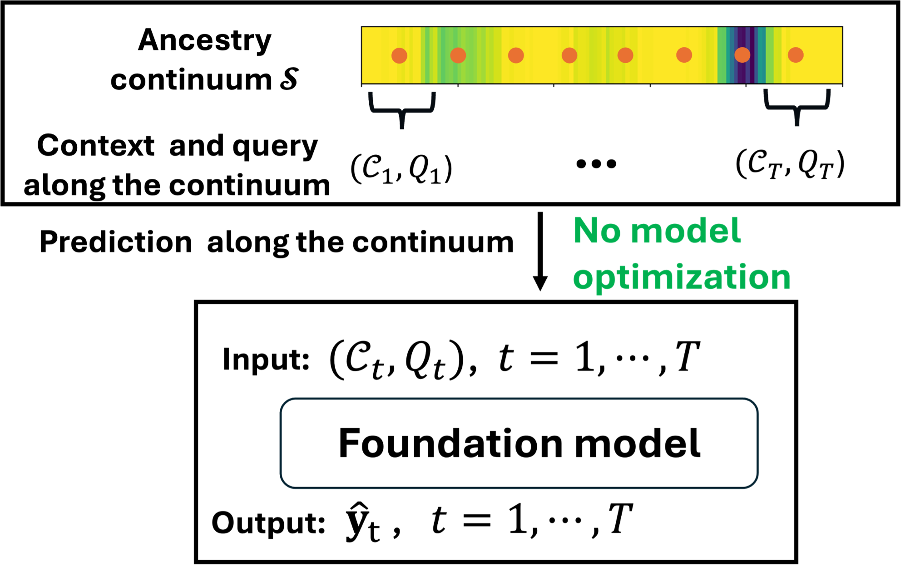
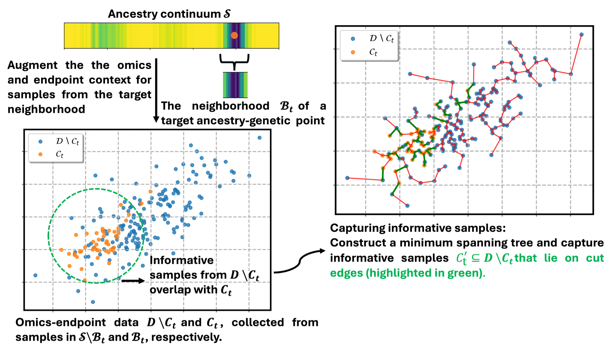
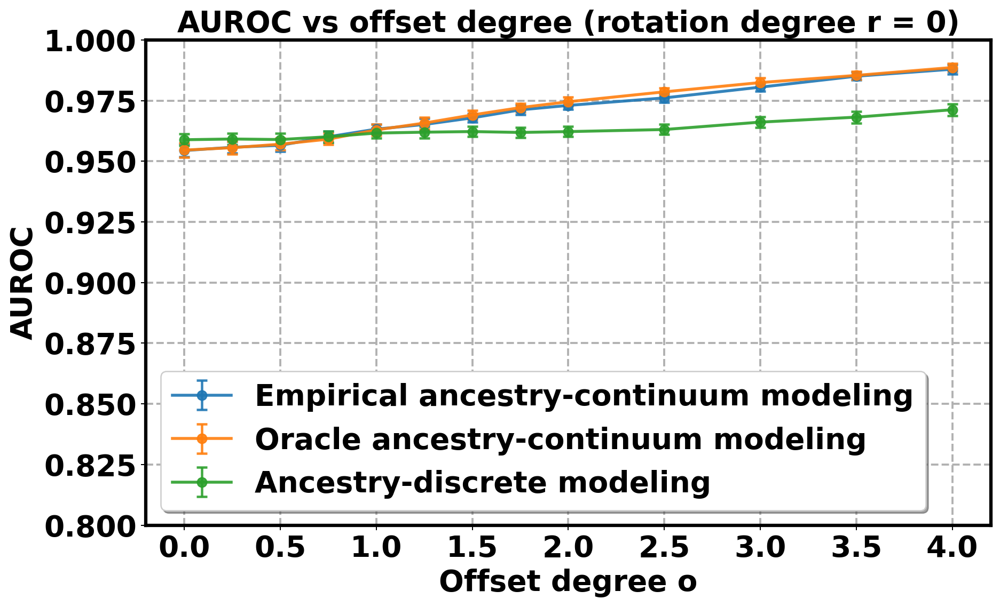
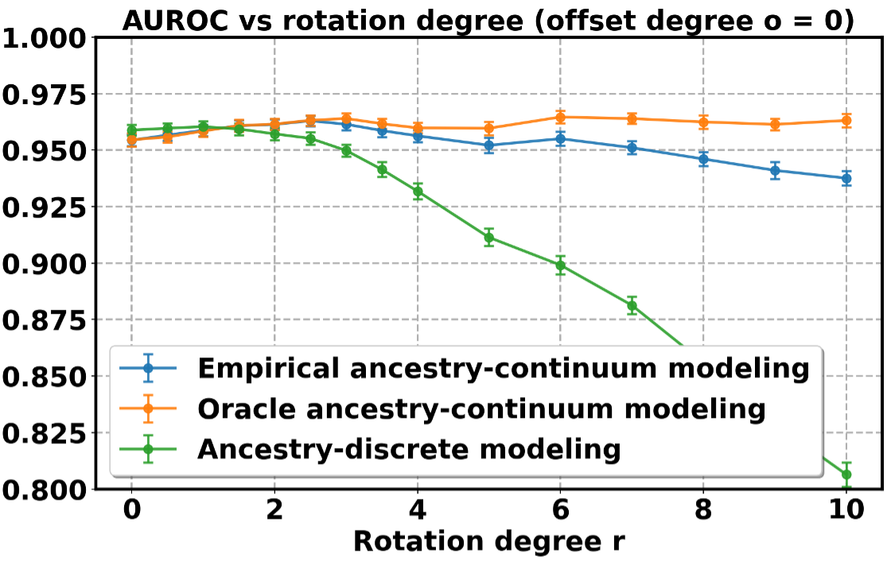
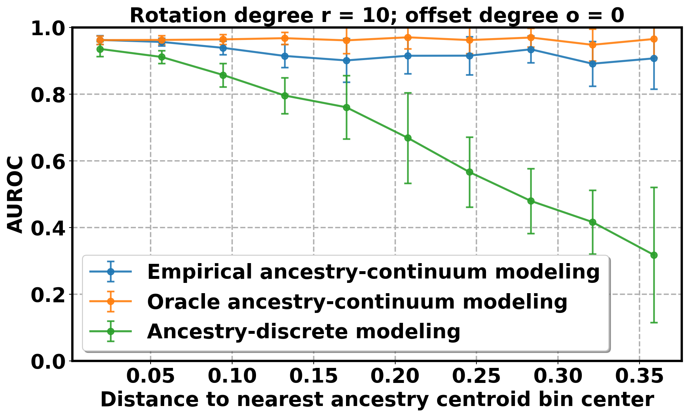
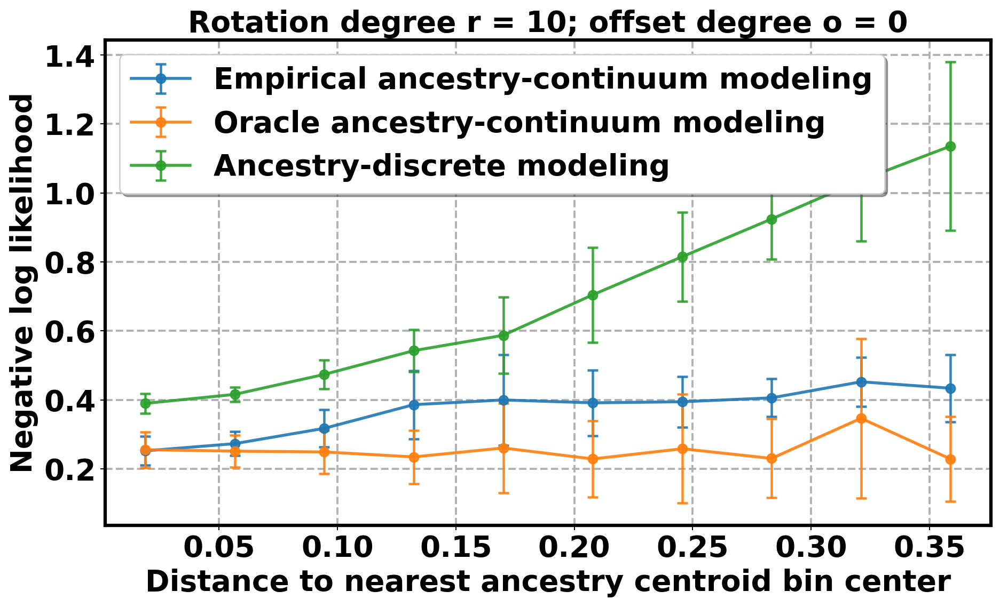

# BIBM 2026 DA-ICL replication

This is the algorithm-focused replication repository for:

> Weizhi Li and Yan Cui. “Beyond Discrete Ancestry Groups: Distribution-Aware In-Context Learning for Cancer Outcome Prediction Across the Genetic Ancestry Continuum.” *2026 IEEE International Conference on Bioinformatics and Biomedicine (BIBM)*. IEEE, 2026.

The repository provides scikit-learn-style implementations of discrete in-context learning (ICL), ancestry-continuum ICL, and distribution-aware ICL (DA-ICL), together with a complete synthetic-data reproduction workflow. TCGA users supply prepared NumPy arrays or pandas DataFrames directly to the estimators.

## Method overview

DA-ICL models ancestry as a continuous genetic coordinate rather than only as a reported group. A query-specific context is formed from genetically nearby development patients, then DACE adds distributionally informative patients selected in omics representation space.

### Figure 1. Distribution-aware ICL for ancestry-continuum modeling

<p align="center">
  
  <br><strong>(a) ICL for ancestry-continuum modeling</strong>
</p>

<p align="center">
  
  <br><strong>(b) Distribution-aware context enhancement</strong>
</p>

## Installation

```bash
git clone <repository-url>
cd BIBM-replication
conda env create -f environment.yml
conda activate bibm-replication
python -m pip install -e .
pytest -q
```

Obtain the TabPFN-2.6 weights from Prior Labs after accepting any applicable model-access terms:

```bash
bibm-replicate fetch-checkpoint --destination checkpoints
bibm-replicate verify-checkpoint checkpoints/tabpfn-v2.6-classifier-v2.6_default.ckpt
```

The expected checkpoint SHA-256 is:

```text
0578fa56f97e11024e31735aaec2c4e7332584b7730242fbaf6c0bbd0299206a
```

## Methodological package

The package exposes three classifiers derived from `sklearn.base.BaseEstimator` and `ClassifierMixin`:

- `DiscreteICLClassifier` uses all development patients matching each query's reported `AFR` or `EUR` ancestry.
- `ContinuumICLClassifier` selects the query's exact 100 nearest patients in standardized genotype PCA30 space from the combined AFR+EUR development pool.
- `DAICLClassifier` starts from the identical KNN100 context, constructs separate class-specific MSTs in standardized AE20 space, and adds outside candidates incident to crossing edges. Labels partition candidate pools but are never distance coordinates.

All classifiers use omics PCA100 features for prediction and the reported settings `n_estimators=32` and `temperature=0.9`. Their `fit()` methods validate and store the development pool; query-specific TabPFN contexts are constructed during `predict_proba()`.

### Input arrays

| Input | Shape | Meaning |
|---|---:|---|
| `X_dev` | `(n_dev, 100)` | Development-patient omics PCA100 prediction features |
| `y_dev` | `(n_dev,)` | Binary development labels encoded as 0/1 |
| `genotype_dev` | `(n_dev, 30)` | Development-patient genotype PCA30 coordinates |
| `ae_dev` | `(n_dev, 20)` | Development-patient omics AE20 features used by DACE |
| `ancestry_dev` | `(n_dev,)` | Reported ancestry, exactly `AFR` or `EUR` |
| `X_test` | `(n_test, 100)` | Query omics PCA100 prediction features |
| `genotype_test` | `(n_test, 30)` | Query genotype PCA30 coordinates |
| `ancestry_test` | `(n_test,)` | Query ancestry, exactly `AFR` or `EUR` |

Every supplied block must contain finite values and aligned rows. The development pool must contain both outcome classes. Sample identifiers are optional; when omitted, development row indices identify context members. See [the prepared-array contract](docs/input_data.md) for details.

### DA-ICL example

```python
from bibm_replication import DAICLClassifier

model = DAICLClassifier(
    n_neighbors=100,
    n_estimators=32,
    temperature=0.9,
    random_state=0,
    device="cuda",
    model_path="checkpoints/tabpfn-v2.6-classifier-v2.6_default.ckpt",
)
model.fit(
    X_dev,
    y_dev,
    genotype_features=genotype_dev,
    dace_features=ae_dev,
    sample_ids=development_ids,
)

probability = model.predict_proba(
    X_test,
    genotype_features=genotype_test,
)[:, 1]
prediction = model.predict(X_test, genotype_features=genotype_test)
context_audit = model.last_context_report_
```

`last_context_report_` records base and DACE-added development indices, optional sample IDs, context sizes, and class composition for every query.

### Discrete and continuum examples

```python
from bibm_replication import ContinuumICLClassifier, DiscreteICLClassifier

checkpoint = "checkpoints/tabpfn-v2.6-classifier-v2.6_default.ckpt"

discrete = DiscreteICLClassifier(model_path=checkpoint).fit(
    X_dev, y_dev, ancestry=ancestry_dev
)
p_discrete = discrete.predict_proba(
    X_test, ancestry=ancestry_test
)[:, 1]

continuum = ContinuumICLClassifier(model_path=checkpoint).fit(
    X_dev, y_dev, genotype_features=genotype_dev
)
p_continuum = continuum.predict_proba(
    X_test, genotype_features=genotype_test
)[:, 1]
```

The complete executable example is [examples/array_api.py](examples/array_api.py). Programmatic evaluation is available through `bibm_replication.binary_metrics`, and fixed conventional baseline factories are provided for elastic net, random forest, and XGBoost.

## Synthetic reproduction

The synthetic workflow generates all required data and evaluates discrete, empirical-continuum, and oracle-continuum logistic models. The paper configuration uses three ancestry centroids, 65% clustered and 35% admixed samples, two uniform omics features, an ancestry-dependent rotated and shifted diagonal boundary, logistic scale 8, 1,000 training samples, 600 test samples, KNN100, and 30 deterministic replicates.

Run the small end-to-end validation:

```bash
bibm-replicate run-synthetic --config configs/synthetic_smoke.yaml
bibm-replicate analyze-synthetic --result-root results/synthetic_smoke
bibm-replicate generate-figures \
  --experiment synthetic \
  --result-root results/synthetic_smoke
```

Reproduce the complete paper sweeps and figures:

```bash
bibm-replicate run-synthetic --config configs/synthetic_paper.yaml
bibm-replicate analyze-synthetic --result-root results/synthetic
bibm-replicate generate-figures --experiment synthetic
```

Generated results are written beneath `results/synthetic/` and never overwrite the canonical manuscript images. Every configuration field, output table, metric, and plotting step is described in [docs/synthetic.md](docs/synthetic.md).

### Figure 2. Synthetic AUROC across offset and rotation

<p align="center">
  
  
</p>

Ancestry-continuum modeling becomes increasingly advantageous as the outcome boundary varies more strongly across the ancestry space. Higher AUROC is better.

### Figure 3. Synthetic performance across genetic distance

<p align="center">
  
  
</p>

The panels show performance as distance to the nearest ancestry-group centroid increases. Higher AUROC and lower negative log-likelihood (NLL) indicate better performance.

## TCGA data access and reported results

Open-access TCGA omics, clinical metadata, and biospecimen metadata can be browsed and downloaded through the [NCI Genomic Data Commons Data Portal](https://portal.gdc.cancer.gov/). The GDC classifies germline variants, SNP6 genotype data, and other identifiable low-level genomic data as controlled access; these inputs may require eRA Commons authentication and dbGaP authorization. See the official [GDC data-access guidance](https://gdc.cancer.gov/access-data/data-access-processes-and-tools).

This repository intentionally does not download or preprocess TCGA, construct outcomes, fit PCA/autoencoder representations, or create patient splits. Authorized users prepare the arrays described above and provide them directly to the classifier API. No individual-level TCGA data are distributed here.

### Figure 4. TCGA AUROC across 18 tasks

<p align="center">
  
</p>

Run-level AUROC distributions compare DA-ICL for ancestry-continuum modeling with ancestry-discrete elastic net, random forest, and XGBoost across 18 TCGA tasks evaluated on AFR test samples. Higher AUROC is better. The de-identified run-level source is [data/figure_data/tcga_core_methods_run_level_auroc.csv](data/figure_data/tcga_core_methods_run_level_auroc.csv).

## Environment and runtime

The paper environment uses Python 3.12.3, CUDA 12.4, PyTorch 2.6.0, `tabpfn==7.1.0` with the TabPFN-2.6 checkpoint, scikit-learn 1.6.1, XGBoost 3.2.0, NumPy 2.1.2, pandas 2.3.1, SciPy 1.16.1, NetworkX 3.3, Matplotlib 3.10.5, and Seaborn 0.13.2. Recreate it with [environment.yml](environment.yml) or [requirements.txt](requirements.txt).

TabPFN inference is intended for one CUDA GPU per process; an NVIDIA H100 with at least 80 GB framebuffer is recommended. The synthetic workflow is CPU-compatible. A synthetic smoke run takes approximately 1–3 minutes, while the complete serial paper sweep takes several CPU-hours depending on the host.

## Repository layout

```text
src/bibm_replication/     estimators, DACE, TabPFN backend, metrics, synthetic workflow
configs/                  paper and smoke configurations
examples/                 direct array API example
jobs/                     CPU synthetic Slurm template
tests/                    estimator, DACE, metric, and synthetic tests
docs/                     algorithms, input contract, figures, environment, validation
figures/manuscript/       canonical manuscript Figures 1–4
data/figure_data/         de-identified aggregate data for Figure 4
results/                  locally generated outputs (git-ignored)
```

## License and citation

Code is released under the [MIT License](LICENSE). Cite the paper using [CITATION.bib](CITATION.bib) or [CITATION.cff](CITATION.cff).

TabPFN-2.6 weights are distributed separately by Prior Labs through the [TabPFN-2.6 model card](https://huggingface.co/Prior-Labs/tabpfn_2_6) and are not relicensed or committed here.
